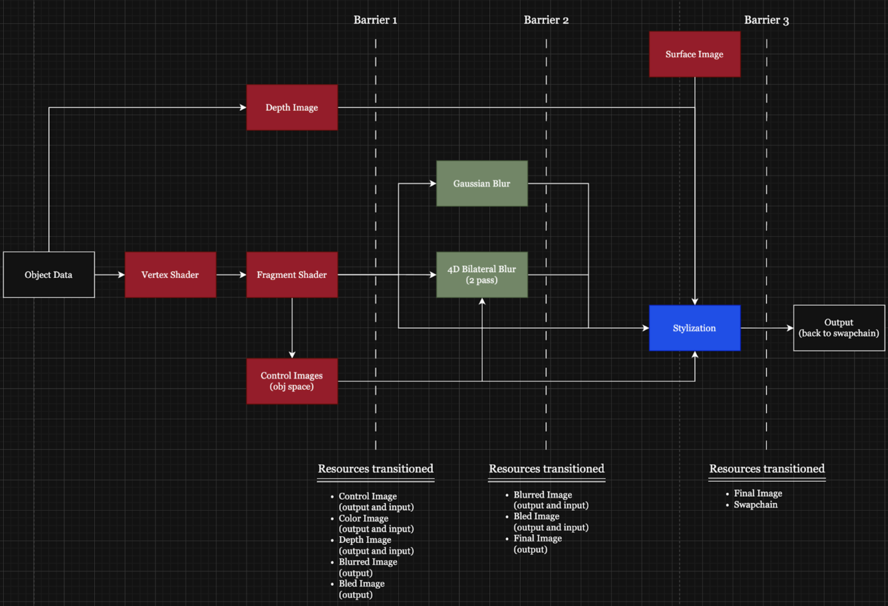
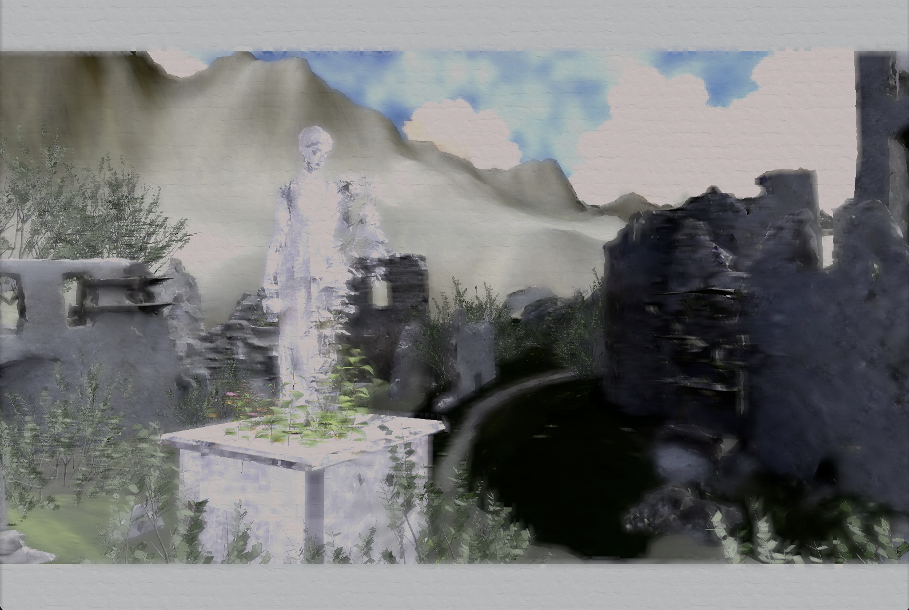

### Real-Time Watercolor Stylization
[Link to repo](https://github.com/tongponghong/15472_watercolor)

I worked with [Ollie Arrison](https://olliearrison.github.io/#/) at the end of 15472 to implement this paper:
[Art-directed watercolor stylization of 3D animations in real-time by Montesdeoca et. al](https://www.sciencedirect.com/science/article/pii/S0097849317300316)

We distributed the work mainly where I handled the boilerplate and pipeline and they handled the shaders and art changes.
This pipeline above can be summarized as so: 
## Code Organization + Render Passes
### (Before) Barrier 1:
We derive all of our color image and control image output from the object fragment shader. The color image is just the direct outColor, and the control image is randomly generated noise based on fractal brownian motion and the position of the vertices from the vertex shader. 
The depth image is derived from the object data and we use the swapchain_depth_image that is included in tutorial.cpp from the nakluV tutorial. 
The blurred and bled images are both prepared to be in the right format (VK_IMAGE_LAYOUT_GENERAL) as outputs of the blur and bilateral blur shaders. 
### (Before) Barrier 2:
The blurred image and bled image are now switched from being written to to being read from since they are now inputs into the stylization shader. 
Final output is now being prepared to be in the correct format (VK_IMAGE_LAYOUT_GENERAL)
### (Before) Barrier 3:
The final image is now changed to be VK_IMAGE_LAYOUT_TRANSFER_SRC_OPTIMAL so that it is ready to be copied to the swapchain image 
Swapchain image output is now being prepared to be in the correct format (VK_IMAGE_LAYOUT_TRANSFER_DST_OPTIMAL)

## Pipeline Organization

### ObjectsPipeline

The setup of the objects pipeline was mostly kept the same. Within the fragment shader, we aimed to replicate the watercolor reflectance model, as described in the paper Art-directed watercolor stylization of 3D animations in real-time. Rather than interpreting lighting through a physically-based model, we used water dilution to represent lighter or darker areas. This matches how artists use water to dilute the paint, resulting in lighter values. The dilution area was calculated by summing over the lights.
The dilution area can intuitively be thought of then as all the area the light touches on a specific surface/mesh. This is not to be confused with the dilution variable, which controls how strongly the color gets diluted towards the paper color. 

<!-- 

The cangiante effect is a non-realistic shift in color as the value shifts from dark to light. Within the paper, this is calculated by adding the cangiante color associated with a given weight to the original scene color. Although this method results in a color shift as the color goes from light to dark, it doesn't entirely capture the transparency-based layering of watercolor paints. Often painters begin by applying a thin layer of blue paint, which appears darker when layered over with the true color of the object in the scene. In order to achieve this, I used the equations for alpha over, setting the background color to the cangiante color, the background opacity to the cangiante strength, the foreground color to the base color, and the foreground opacity to the dilution area. 
We replicated the cangiante effect according to the paper, which resulted in the following image:
 -->

Although this resulted in color shift from the original texture, it involved adding the offset color to the original albedo, which makes the color brighter. However, often with watercolor, since this effect is acheived through layering, it results in darkening certain areas of the painting according to this effect. Using our version, we got the following image:

### ComputePipeline
The ComputePipeline directs the Gaussian Blur shader (gaussian.comp). Since it only involves one input image and one output image, it has 2 bindings. Since the paper suggested using a constant and small kernel size, the kernel was created using the python script computeKernel.py.
The result of the gaussian filter over the scene can be seen below. 

### BleedPipeine
The BleedPipeline directs the 4D Bilateral Blur shader (bilateral.comp). Since there are 3 input images and 1 output image, it has 4 bindings. The goal of the bilateral filter is to replicate the bleeding seen in watercolor. 
In order to acheive this effect, it blurs areas of the painting together based on the depth of the surrounding pixels. In order to get the flattened depth, 
we added the near and far clipping values as push constants and used them to linearize the depth, which resulted in the following image:

Then, the following image shows the pixels that are nearby that are sufficiently far enough behind the current pixel. 

Following the paper resulted in this image which allows color to blur from areas that are in front but not from areas that are behind.

Since we found that this reduced the detail within the scene, we choose to avoid blurring over areas with significant depth change. This allowed much of the silhouette to be preserved while still bluring much of the image. 

### StylePipeline
The StylePipeline is the final pipeline that directs the final stylization shader (style.comp). Since there are 5 input images and 1 output image, it has 6 bindings total. Using the control image, which was set using FBM noise generated in the fragment shader, the gaussian blurred image and the bleed image are combined to result in an image that blurs some areas while sharpening others. 

The paper texture is layered on top, resulting in the final image:

If all previously mentioned effects are set to match the original paper it produces the following image. 

<!-- <figure>
<!-- Feel free to use and duplicate the below example graph to plot data
 	 Edit labels and variables in script below the canvas -->
<!-- <canvas id="Bilateral-blur-data" style="display:block; width:100%; max-width:600px; margin:0 auto; background:#fff;"></canvas>
<figcaption>
The frame time performance based on various kernel sizes for our bilateral blur filter. The gaussian blur remained at an 11 size kernel. 
</figcaption>
</figure>
 --> 

